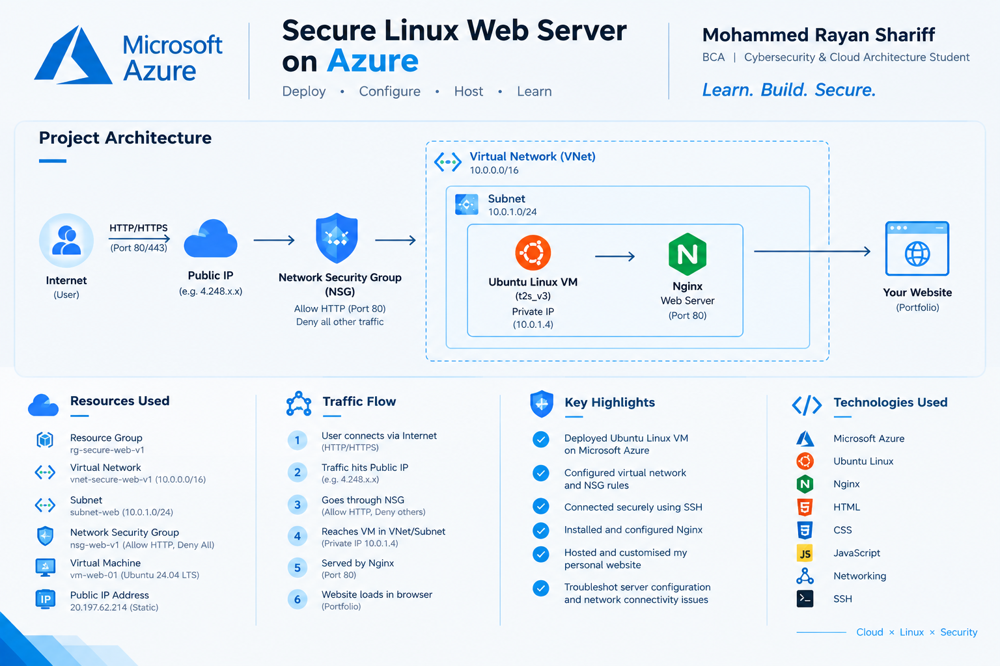

# secure-linux-web-server-azure
Secure Linux Web Server on Microsoft Azure using Ubuntu and Nginx
# Secure Linux Web Server on Microsoft Azure

A hands-on cloud infrastructure project focused on deploying an Ubuntu Linux web server and hosting a personal portfolio website using Nginx.

## Project Overview

This project demonstrates how to deploy a Linux-based web server on Microsoft Azure, configure network access, and serve a website over HTTP.

## Architecture

**User / Browser → Internet → Azure Public IP → Network Security Group → Virtual Network → Subnet → Ubuntu VM → Nginx → Portfolio Website**

## Technologies Used

- Microsoft Azure
- Ubuntu Linux
- Nginx Web Server
- Azure Virtual Network (VNet)
- Subnetting
- Network Security Group (NSG)
- SSH
- HTML, CSS and JavaScript

## Key Implementation Steps

1. Deployed an Ubuntu Linux virtual machine on Azure.
2. Configured a virtual network and subnet.
3. Configured NSG inbound rules to allow the required web traffic on TCP port 80.
4. Connected to the virtual machine using SSH.
5. Installed and configured Nginx.
6. Hosted a personal portfolio website.
7. Tested the web server and troubleshot configuration and connectivity issues.

## Security Considerations

- Used SSH key-based authentication for server access.
- Configured inbound network rules to control access to the VM.
- Allowed HTTP traffic on port 80 to serve the website.
- SSH access should be restricted to trusted IP addresses whenever possible.
- Private keys and credentials must never be committed to the repository.

## What I Learned

- Deploying and managing Linux virtual machines in Azure.
- Understanding cloud networking, virtual networks and subnets.
- Configuring NSG rules and troubleshooting connectivity.
- Hosting websites with Nginx.
- Using SSH to administer a remote Linux server.

## Project Files

- `index.html` — Personal portfolio website hosted on the server.

## Project Status

The deployment was completed as a learning project. The Azure VM may be stopped or deallocated to control costs, so the hosted website may not always be accessible.

## Author

**Mohammed Rayan Shariff**

BCA Student | Cybersecurity and Cloud Architecture

- GitHub: https://github.com/MRshariff
- LinkedIn: https://www.linkedin.com/in/mohammed-rayan-shariff-4700413b8/

---

*Built as part of my hands-on learning journey in cloud computing, Linux administration and cybersecurity.*
## Architecture Diagram

